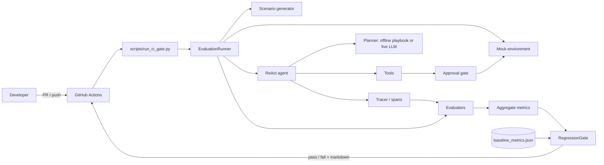

# Architecture

## 1. Context

OpsEvalGate has one job: make changes to an incident-triage agent *measurable*, and refuse to merge changes that make it worse. The system is a library plus a CI entry point; there is no server.

## 2. Layers

| Layer | Responsibility | Modules |
| :--- | :--- | :--- |
| **Scenario** | Produce seeded incidents with golden answers (golden data stays out of the agent's view) | `scenario_generator`, `schemas` |
| **Environment** | Isolated, per-scenario mock logs/DB and bound tools | `mock_infra` |
| **Agent** | Reason/act loop, iteration cap, scratchpad | `agent_core`, `agent_router` |
| **Policy** | What a tool call may do: guardrail (deny-list, arg screening), approval gate (fail-closed) | `adversarial/guardrails`, `approval_gate` |
| **Observability** | Spans for every step; session save/replay | `tracer`, `trace_replay`, `trace_parser` |
| **Evaluation** | Deterministic guards, trajectory metrics, judge, step judge, calibration | `evals/evaluators/` |
| **Gate** | Baseline comparison, thresholds, report | `eval_gate`, `scripts/run_ci_gate.py` |
| **Diagnostics** | Failure taxonomy, pivot-step attribution, few-shot feedback | `failure_classifier`, `attribution_reporter`, `prompt_optimizer` |
| **Cost** | Cache layout, context compaction, Pareto report | `evals/cost/` |

Dependencies point inward: evaluators and the runner depend on schemas and the agent, never the reverse. The agent receives its tools and planner by injection.

## 3. Runtime flow of one scenario

1. The runner opens `MockEnvironmentFactory.sandbox(scenario)`, which seeds logs and DB rows for this scenario only.
2. The environment's bound tools are wrapped by `ApprovalGate` (read-only tools pass, others ask the approver).
3. A planner is built from the **observable** service names; it sees the prompt and observations only.
4. `ReActAgent.run` loops up to `max_iterations`: plan, call tool, record observation. Each step emits a span.
5. Three evaluators score the session: deterministic rules, trajectory precision/recall against the golden trajectory, and the judge.
6. Reports are aggregated into batch metrics; the gate compares them with the stored baseline.

Complexity: a batch is `O(S * I)` agent steps for `S` scenarios and `I` iterations (cap 5); evaluators are linear in steps. Memory is bounded by the span buffer and a 1000-entry audit log.

## 4. Why this architecture

Full records (context, decision, consequences, alternatives) are in [DECISIONS.md](DECISIONS.md). In short:

| Choice | Reason | ADR |
| :--- | :--- | :--- |
| Evaluation harness plus CI gate as the product | Agent quality changes with every edit; only an automatic gate makes regression a build failure | 1, 7, 10, 11 |
| Deterministic, offline-first evaluation | Live LLM calls are slow, costly, flaky and need secrets in CI | 2 |
| Rule-based planner blind to golden answers | A planner that always answers correctly makes a 100% baseline meaningless | 3 |
| Small explicit ReAct loop with an iteration cap | Every step stays traceable and testable; bounded cost | 4 |
| Layered tool safety, fail-closed approval | Regex guardrails alone are bypassable; unknown tools must not run unattended | 5, 6, 12 |
| Span tracing as audit trail | Failures can be replayed and attributed to a step | 8 |
| Plain Python, injected dependencies | Small supply-chain surface; every part swappable in tests | 9 |
| Test-first development | The tool's own controls must be provably enforced | 14 |

Alternatives rejected: a full agent framework (hides the loop we must trace), manual prompt QA (not enforceable on PRs), live-LLM evaluation in CI (cost, flakiness, secrets), absolute-threshold-only gating (cannot express "no worse than before"), and a destructive-tool denylist (fails open for new tools).

## 5. Deployment view

One GitHub Actions job on `ubuntu-24.04`, Python 3.9, triggered on pull requests, pushes to `main` and manual dispatch. It installs `requirements.txt`, runs `pytest`, then the gate, then appends the report to the job summary and (on PRs) posts it as a comment. No provider secrets are used.

## 6. Known architectural gaps

- The mock tools in `agent_core` mutate module-level state (`MOCK_DATABASE`, `MOCK_LOGS`). A caller that passes `tools=` explicitly to `ReActAgent` chooses its own gating; only the no-argument default is deny-all.
- Observations are not sanitized before entering the scratchpad.
- Global tracer and module-level mock state prevent parallel runs.
- No timeout or token/cost cap on a run; approvers are synchronous with no timeout.
