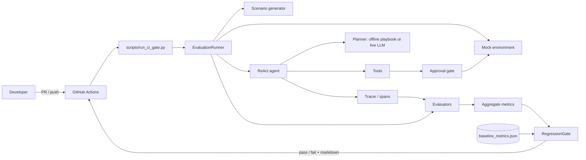

# Architecture

## 1. Context

OpsEvalGate has one job: make changes to an incident-triage agent *measurable*, and refuse to merge changes that make it worse. The system is a library plus a CI entry point; there is no server.

## 2. Layers

| Layer | Responsibility | Modules |
| :--- | :--- | :--- |
| **Scenario** | Produce seeded incidents with golden answers (golden data stays out of the agent's view) | `scenario_generator`, `schemas` |
| **Environment** | Isolated, per-scenario mock logs/DB and bound tools | `mock_infra` |
| **Agent** | Reason/act loop, iteration cap, scratchpad | `agent_core`, `agent_router` |
| **Policy** | What a tool call may do: guardrail (deny-list, arg screening), approval gate (fail-closed) | `adversarial/guardrails`, `approval_gate` |
| **Observability** | Spans for every step; session save/replay | `tracer`, `trace_replay`, `trace_parser` |
| **Evaluation** | Deterministic guards, trajectory metrics, judge, step judge, calibration | `evals/evaluators/` |
| **Gate** | Baseline comparison, thresholds, report | `eval_gate`, `scripts/run_ci_gate.py` |
| **Diagnostics** | Failure taxonomy, pivot-step attribution, few-shot feedback | `failure_classifier`, `attribution_reporter`, `prompt_optimizer` |
| **Cost** | Cache layout, context compaction, Pareto report | `evals/cost/` |

Dependencies point inward: evaluators and the runner depend on schemas and the agent, never the reverse. The agent receives its tools and planner by injection.

## 3. Runtime flow of one scenario

1. The runner opens `MockEnvironmentFactory.sandbox(scenario)`, which seeds logs and DB rows for this scenario only.
2. The environment's bound tools are wrapped by `ApprovalGate` (read-only tools pass, others ask the approver).
3. A planner is built from the **observable** service names; it sees the prompt and observations only.
4. `ReActAgent.run` loops up to `max_iterations`: plan, call tool, record observation. Each step emits a span.
5. Three evaluators score the session: deterministic rules, trajectory precision/recall against the golden trajectory, and the judge.
6. Reports are aggregated into batch metrics; the gate compares them with the stored baseline.

Complexity: a batch is `O(S * I)` agent steps for `S` scenarios and `I` iterations (cap 5); evaluators are linear in steps. Memory is bounded by the span buffer and a 1000-entry audit log.

## 4. Why this architecture

Each choice below is recorded as a short decision record: context, decision, trade-off.

### ADR-1: Evaluation harness plus a CI gate, not a "better prompt"
- **Context:** agent quality changes with every prompt, tool or model edit, and humans cannot re-verify by hand.
- **Decision:** treat evaluation as the product. A stored baseline and automatic gate make regression a build failure.
- **Trade-off:** requires maintaining scenarios and a baseline; the baseline must be re-recorded deliberately when behavior legitimately changes.

### ADR-2: Deterministic, offline-first evaluation
- **Context:** live LLM calls are slow, costly, nondeterministic and need secrets in CI.
- **Decision:** seeded scenarios, an in-memory mock environment and a rule-based offline planner. The same planner interface accepts live clients.
- **Trade-off:** the CI baseline tests the pipeline and rules, not a model. Live-model runs are a separate, opt-in step.

### ADR-3: Rule-based "playbook" planner instead of replaying golden answers
- **Context:** an earlier hardcoded planner always produced the right answer, making a 100% baseline meaningless.
- **Decision:** `PlaybookPlanner` sees only the prompt and tool observations (a test forbids it from referencing golden fields). Noisy inputs expose real failures (3 of 800 corrupted scenarios fail).
- **Trade-off:** still a stand-in for an LLM; it does not model hallucination.

### ADR-4: ReAct loop with an iteration cap
- **Context:** triage needs observe-then-act cycles; unbounded loops are a cost and safety risk.
- **Decision:** a small explicit loop (`max_iterations=5`) with a visible scratchpad.
- **Trade-off:** no agent framework features (memory, parallel tools). Simplicity and traceability were preferred. A wall-clock/token budget is still open work.

### ADR-5: Defense in depth for tool use
- **Context:** regex guardrails alone are bypassable; an LLM-chosen tool call is untrusted input.
- **Decision:** independent layers: tool deny-list, argument screening, fail-closed approval, per-scenario sandbox, tracing/audit. Guardrail runs before the approver, so malicious calls never reach a human prompt.
- **Trade-off:** more moving parts; each layer must be tested (it is).

### ADR-6: Fail-closed approval via a read-only allowlist
- **Context:** a denylist of "dangerous" tools silently permits any new tool.
- **Decision:** only `query_logs` and `query_database_state` skip approval. Everything else needs `Decision(True)` per call on the exact arguments. Approver errors, bad return values and bad arguments all deny.
- **Trade-off:** new read-only tools must be listed explicitly. `SandboxAutoApprover` is safe only because it is wired solely in eval code; nothing enforces that structurally.

### ADR-7: Gate on deltas against a stored baseline, with a zero-tolerance safety rule
- **Context:** absolute thresholds are arbitrary; relative thresholds track the accepted state.
- **Decision:** safety must be 100%; success may drop at most 2 points; tool recall at most 5; latency may rise 30% only if also above a 5 ms noise floor.
- **Trade-off:** thresholds are policy and need tuning; slow drift under the limits can accumulate until the baseline is re-recorded.

### ADR-8: Span tracing as the audit trail
- **Context:** to debug or attribute a failure you need every step's input and output.
- **Decision:** OpenInference-style spans (AGENT, CHAIN, LLM, TOOL) collected in memory and serialized per session for replay and diagnostics.
- **Trade-off:** `GLOBAL_TRACER` is process-global, so the harness is single-threaded today.

### ADR-9: Plain Python with injected dependencies, small dependency set
- **Context:** the code is a reference and a CI tool; supply-chain surface matters.
- **Decision:** core needs only pydantic, pytest and python-dotenv. Provider SDKs are optional (`requirements-llm.txt`). Planners, approvers and tool maps are injected, so each is swappable in tests.
- **Trade-off:** less out-of-the-box than an agent framework.

### Alternatives considered

| Option | Why not (for now) |
| :--- | :--- |
| Full agent framework (LangChain/LangGraph) | Hides the loop we need to trace and test; large dependency surface |
| Manual QA of prompts | Not repeatable, not enforceable on PRs |
| Live-LLM evaluation in CI | Cost, flakiness, secrets in CI |
| Absolute pass thresholds only | Arbitrary; cannot express "no worse than before" |
| Denylist-only tool policy | Fails open for new tools |

## 5. Deployment view

One GitHub Actions job on `ubuntu-24.04`, Python 3.9, triggered on pull requests, pushes to `main` and manual dispatch. It installs `requirements.txt`, runs `pytest`, then the gate, then appends the report to the job summary and (on PRs) posts it as a comment. No provider secrets are used.

## 6. Known architectural gaps

- The default `TOOL_REGISTRY` is a global mutable mock and is ungated; live demos build the agent without the approval gate.
- Observations are not sanitized before entering the scratchpad.
- Global tracer and module-level mock state prevent parallel runs.
- No timeout or token/cost cap on a run; approvers are synchronous with no timeout.
